# Dual-LLM customer support for n8n (Claude + Gemini, Oracle ORDS, Turso)

An importable n8n workflow that answers customer support email and website
chat with two models working together:

- **Claude** (Anthropic API) drafts the reply from your FAQ knowledge base,
  the conversation history and, for verified customers, their own account
  data from Oracle.
- **Gemini** (Google AI Studio) cross-checks every draft against the same
  context.
- The reply goes out automatically only when both models are confident and
  agree. Everything else goes to a human in Slack, and the customer gets a
  polite holding message.

Account data is read from an **Oracle Autonomous Database** through
read-only ORDS REST endpoints. Conversation state, the FAQ and the
escalation log live in **Turso** (libSQL), reached through its HTTP API.
Everything runs inside n8n with native nodes, HTTP Request nodes and plain
JavaScript Code nodes: no community nodes, no custom code outside n8n.

```
/
├── workflows/
│   ├── support-dual-llm.json   # main workflow (66 nodes incl. 13 sticky notes)
│   └── error-handler.json      # Error Trigger workflow → Turso system_error + Slack
├── prompts/                    # mirror copies of the 📝 PROMPTS node
│   ├── claude-system.md
│   ├── gemini-reviewer.md
│   └── holding-messages.md
├── oracle/ords-setup.sql       # read-only user, views, grants, ORDS handlers, OAuth client
├── turso/
│   ├── schema.sql              # tables, indexes, FTS5 + sync triggers
│   └── seed-faq.sql            # 12 example FAQ rows
├── chat-widget/
│   ├── index.html              # GitHub Pages demo page
│   └── widget.js               # embeddable chat bubble (vanilla JS)
├── docs/sample-faq.md          # human-readable FAQ, mirrored in seed-faq.sql
├── tests/sample-messages.md    # sample messages + acceptance tests A–E
├── .env.example                # every setting, marked credential / CONFIG / widget
└── LICENSE                     # MIT
```

---

## 1. Architecture

```mermaid
flowchart LR
  subgraph Triggers
    IMAP["📥 Email Trigger (IMAP)"]
    HOOK["💬 Chat Webhook<br/>POST /webhook/support-chat"]
  end
  W["chat-widget/widget.js<br/>(GitHub Pages)"] -->|message + sessionToken| HOOK
  IMAP --> CFG["⚙️ CONFIG → 📝 PROMPTS → 🧭 NORMALIZE"]
  HOOK --> CFG
  CFG --> OR["🏦 Oracle ORDS<br/>customer by email<br/>(4 s timeout)"]
  CFG --> TL["🗄️ Turso pipeline<br/>conversation · last 10 messages<br/>top 5 FAQ · session token"]
  OR --> M["🔗 Merge + 🧩 Assemble<br/>identity check"]
  TL --> M
  M -->|verified| ACC["🏦 ORDS orders + tickets<br/>?limit=5"]
  ACC --> CL
  M -->|unverified| CL["🤖 Claude draft<br/>strict JSON"]
  CL --> GM["🔎 Gemini cross-check<br/>strict JSON"]
  GM --> D{"✅ DECISION<br/>both ≥ threshold,<br/>agree, no needs_human,<br/>valid JSON, policy guard"}
  CL -.API error / bad JSON.-> D
  D -->|yes| AUTO["✉️ Auto reply"]
  D -->|no| ESC["🧑‍💼 Holding reply<br/>+ masked summary"]
  AUTO --> R{"📮 channel"}
  ESC --> R
  R -->|email| SMTP["📧 SMTP Re: subject"]
  R -->|chat| RESP["💬 Respond to Webhook<br/>{ reply, conversationId }"]
  SMTP --> LOG["📝 Turso writes after reply<br/>messages · escalations"]
  RESP --> LOG
  LOG -->|escalated| SL["💬 Slack alert"] --> TS["🗄️ escalations.slack_ts"]
  ERR["🚨 error-handler.json"] -.-> TS2["Turso system_error + Slack"]
```



### Design decisions and trade-offs

- **Oracle through ORDS handlers, not AutoREST.** AutoREST exposes tables
  with generic URLs and every column. Hand-written handlers over three
  views give exactly the three URLs and JSON shapes the workflow needs, and
  the views physically exclude card numbers, payment tokens, billing
  addresses and internal ticket notes. The API user `SUPPORT_RO` can only
  `SELECT` from those views.
- **Oracle is never on the critical path.** Every ORDS call has a hard
  4-second timeout and no retry; a timeout or error becomes
  `account_lookup = "unavailable"` instead of an exception. FAQ questions
  still get answered; questions that need account data are escalated.
- **Identity before account data.** Email: the sender address must equal the
  Oracle account email. Chat: the widget must send a session token that
  exists and has not expired in Turso `session_tokens`, and whose email and
  customer id match the Oracle account. Chat without a token never calls
  Oracle. Unverified Oracle results are dropped before any model sees them.
- **One place for the Turso wire format.** All Turso traffic flows through
  a small gateway: callers emit plain `{ key, sql, args }` statements;
  **🗄️ Turso: Encode Pipeline** builds the Hrana `/v2/pipeline` body, one
  HTTP node sends it, **Decode** turns results into rows and a Switch routes
  each result back to its caller by `purpose`. Changing the format means
  editing one Code node.
- **Retrieval is FTS5 with a LIKE fallback in one round trip.** Both
  queries go in the same pipeline request; a missing FTS table only fails
  its own statement.
- **Writes happen after the reply.** The customer gets their answer first;
  then one Code node emits up to two pipeline calls (messages and the
  escalation), which the HTTP node sends in parallel.
- **Strict JSON from both models.** Claude uses structured outputs
  (`output_config.format` with a JSON schema); Gemini uses
  `responseMimeType: application/json` with a `responseSchema`. Both are
  still validated field by field; anything malformed goes to a human.
- **Exponential backoff where it matters.** n8n's built-in retry uses a
  fixed delay, so the Claude and Gemini calls have an explicit retry loop
  (Switch → Wait → rebuild request): up to 3 attempts on 429/5xx/529/timeouts,
  0.5 s then 1 s for chat (within the 8-second budget), 1/2/4 s for email.
  Turso, Slack and SMTP use n8n's native 3-attempt retry.

### Known limitations (read before going live)

- **Email threading headers.** n8n's native Send Email (SMTP) node has no
  option for custom headers, so it cannot set `In-Reply-To`/`References`.
  Replies use `Re: <original subject>` and quote the original message, which
  Gmail and Outlook thread in most cases. Exact header threading would need
  a different send path, which the "native nodes only" constraint rules out.
- **n8n runs branches one after another.** The Oracle and Turso branches are
  independent and merge without failing each other, but n8n executes them
  sequentially, so their times add up. On a normal day both take well under
  a second; during an ORDS outage the 4-second timeout is added to the chat
  reply time.
- **CORS header.** The Webhook node sends `Access-Control-Allow-Origin` for
  any origin (`*`) so the import works unedited. The real origin check is in
  **🧭 NORMALIZE** using `WEBHOOK_ALLOWED_ORIGINS` (requests from other origins
  get HTTP 403). You can also set the webhook's *Allowed Origins (CORS)*
  option to your domains.
- **Session tokens come from your site.** The workflow only reads
  `session_tokens`. Your website's login backend must insert a row when a
  customer signs in (see [Section 9](#9-embed-the-chat-widget)).

---

## 2. Prerequisites

| Need | Notes |
|---|---|
| **n8n** | Tested on **n8n 2.46.6** (self-hosted). Uses Code v2, HTTP Request 4.2, Merge 3.2, IF 2.2, Switch 3.2, Set 3.4, Webhook 2, Respond to Webhook 1.1, Wait 1.1, Email Trigger (IMAP) 2, Send Email 2.1, Slack 2.3. |
| **Self-hosted** | The chat webhook must be reachable over HTTPS. Set `WEBHOOK_URL=https://your-n8n-host/` in n8n's environment so the node shows the public URL. Keep the default execution order `v1` (set in the workflow). |
| **n8n Cloud** | Works as is. Webhooks are public by default; IMAP polling is allowed. |
| **CORS** | The widget calls the webhook from your site's origin with `Content-Type: application/json`. n8n answers the preflight `OPTIONS` request itself. Put your origins in `WEBHOOK_ALLOWED_ORIGINS`. If a reverse proxy sits in front of n8n, make sure it passes `OPTIONS` through and does not strip `Access-Control-*` headers. |
| **Oracle Autonomous Database** | ORDS is enabled by default on ADB. You need the ADMIN password and the wallet (for SQLcl) or Database Actions access. |
| **Turso** | A database and an auth token (`turso db create`, `turso db tokens create`). |
| **Anthropic** | An API key with access to `claude-sonnet-5-5` (or your chosen model). |
| **Google AI Studio** | An API key for the Gemini API. |
| **Slack** | A bot token with `chat:write` and a channel id. |
| **Mailbox** | IMAP and SMTP access for the support address. |

---

## 3. Oracle setup

1. **Edit the four `DEFINE` lines** at the top of `oracle/ords-setup.sql`:
   `app_schema` (the schema that owns your customer tables), `ro_password`,
   `tns_alias` (e.g. `mydb_high`) and `support_mail`.
2. **Map your tables (only if they differ).** The script creates demo
   tables (`CUSTOMERS`, `ORDERS`, `ORDER_ITEMS`, `SUPPORT_TICKETS`) only when
   `app_schema` has no `CUSTOMERS` table. If you have real tables with other
   names or columns, change only the `SELECT` lists of the three views in
   step 2 of the script, keeping the column aliases.
3. **Run it as ADMIN with SQLcl:**

   ```bash
   sql /nolog
   SQL> set cloudconfig /path/to/Wallet_mydb.zip
   SQL> connect admin@mydb_high
   SQL> @oracle/ords-setup.sql
   ```

   Part 1 (as ADMIN) creates the views and the read-only user and REST-enables
   it; Part 2 reconnects as `SUPPORT_RO` and defines the ORDS module. With
   Database Actions instead of SQLcl, run Part 1 as ADMIN, then sign in as
   `SUPPORT_RO` and run Part 2 (from the `CONNECT` line down).

   The grants the script applies:

   ```sql
   GRANT CREATE SESSION TO support_ro;
   GRANT SELECT ON SHOP.support_customers_v TO support_ro;
   GRANT SELECT ON SHOP.support_orders_v    TO support_ro;
   GRANT SELECT ON SHOP.support_tickets_v   TO support_ro;
   ALTER USER support_ro QUOTA 0 ON data;
   ```

4. **Handlers, not AutoREST.** The script uses ORDS handler definitions
   (module `support.v1`, base path `/support/`). AutoREST stays off for these
   objects; `p_auto_rest_auth => TRUE` keeps anything AutoREST-enabled later
   behind authentication.
5. **Confirm with curl** (base URL is `https://<host>/ords/support_ro`):

   ```bash
   ORDS=https://your-adb-id.adb.us-ashburn-1.oraclecloudapps.com/ords/support_ro
   curl -u SUPPORT_RO:'your-password' "$ORDS/support/health"
   curl -u SUPPORT_RO:'your-password' "$ORDS/support/customers/by-email/ada.okafor%40example.com"
   curl -u SUPPORT_RO:'your-password' "$ORDS/support/customers/C-10042/orders?limit=5"
   curl -u SUPPORT_RO:'your-password' "$ORDS/support/customers/C-10042/tickets?limit=5"
   # Without credentials every call must return 401:
   curl -i "$ORDS/support/customers/C-10042/orders"
   ```

   Expected shapes:

   ```json
   {"customer_id":"C-10042","full_name":"Ada Okafor","email":"ada.okafor@example.com","plan":"plus","status":"active","created_at":"2024-03-14T10:12:00Z"}
   {"items":[{"order_id":"NW-58211","order_date":"…","status":"shipped","total":129.9,"currency":"USD","carrier":"UPS","tracking_number":"1Z999AA10123456784","items":[{"sku":"KTL-200","name":"Stovetop kettle, 2 L","quantity":1}]}],"hasMore":false,"limit":5,…}
   ```

6. **Authentication options.** The workflow ships with **Basic Auth** as
   `SUPPORT_RO` (ORDS database authentication). To use **OAuth2** instead,
   take the `client_id` and `client_secret` the script prints, create an n8n
   *OAuth2 API* credential (grant type *Client Credentials*, Access Token URL
   `<ORACLE_ORDS_BASE_URL>/oauth/token`), and switch the three 🏦 HTTP nodes to
   *Predefined credential type → OAuth2 API*.

---

## 4. Turso setup

```bash
turso auth login
turso db create support-bot
turso db show support-bot --url          # → libsql://support-bot-yourorg.turso.io
turso db tokens create support-bot       # → the Bearer token for n8n

turso db shell support-bot < turso/schema.sql
turso db shell support-bot < turso/seed-faq.sql
```

Use the URL with `https://` in CONFIG (`libsql://` is also accepted and
converted). Confirm the HTTP endpoint the workflow uses:

```bash
export TURSO_DATABASE_URL=https://support-bot-yourorg.turso.io
export TURSO_AUTH_TOKEN=eyJ...
curl -s "$TURSO_DATABASE_URL/v2/pipeline" \
  -H "Authorization: Bearer $TURSO_AUTH_TOKEN" \
  -H "Content-Type: application/json" \
  -d '{"requests":[{"type":"execute","stmt":{"sql":"SELECT count(*) AS n FROM faq"}},{"type":"close"}]}'
# → {"baton":null,"base_url":null,"results":[{"type":"ok","response":{"type":"execute","result":{"cols":[{"name":"n",...}],"rows":[[{"type":"integer","value":"12"}]],...}}},{"type":"ok","response":{"type":"close"}}]}
```

If your Turso database rejects the FTS5 section of `schema.sql`, delete the
`faq_fts` table and its three triggers from the file and re-run it. Retrieval
then uses the LIKE fallback automatically.

---

## 5. n8n setup, step by step

1. **Import both workflows.** *Workflows → Create → ⋯ → Import from File*:
   `workflows/error-handler.json`, then `workflows/support-dual-llm.json`.
2. **Create the credentials** (*Credentials → Add credential*). Use these
   names so the nodes pick them up; otherwise open each red node and select
   the credential.

   | Credential type | Name | Fields |
   |---|---|---|
   | Header Auth | `Anthropic API Key (x-api-key)` | Name `x-api-key`, Value = Anthropic key |
   | Query Auth | `Google AI Studio Key (key)` | Name `key`, Value = Google AI Studio key |
   | Bearer Auth | `Turso Auth Token (Bearer)` | Bearer Token = Turso token |
   | Basic Auth | `Oracle ORDS SUPPORT_RO (Basic Auth)` | User `SUPPORT_RO`, Password |
   | Slack API | `Slack Bot (support alerts)` | Access Token `xoxb-…` |
   | IMAP | `Support Mailbox (IMAP)` | host, port 993, user, password, SSL/TLS on |
   | SMTP | `Support Mailbox (SMTP)` | host, port 465 (or 587 + STARTTLS), user, password |

   The error workflow uses the Turso and Slack credentials too.
3. **Fill ⚙️ CONFIG** in the main workflow:

   | Field | Default | What it does |
   |---|---|---|
   | `CONFIDENCE_THRESHOLD` | `0.8` | Minimum confidence for both models to auto-send |
   | `CLAUDE_MODEL` | `claude-sonnet-5-5` | Drafting model |
   | `CLAUDE_EFFORT` | `low` | Claude reasoning effort (`low` keeps chat fast) |
   | `CLAUDE_REFUSAL_FALLBACK` | `default` | Server-side fallback if Claude declines; `off` to disable |
   | `GEMINI_MODEL` | `gemini-flash-latest` | Reviewer model; pin a specific version id for stable behaviour |
   | `SLACK_CHANNEL_ID` | `C0123456789` | Where escalations are posted |
   | `COMPANY_NAME` | `Northwind Goods` | Used in prompts and messages |
   | `SUPPORT_SIGNATURE` | two lines | Appended to email replies |
   | `SUPPORT_FROM_EMAIL` | `support@example.com` | From/Reply-To; mail from it is ignored |
   | `MAX_TOKENS` | `1024` | Claude output cap |
   | `ORACLE_ORDS_BASE_URL` | placeholder | `https://<host>/ords/support_ro` |
   | `TURSO_DATABASE_URL` | placeholder | `https://<db>-<org>.turso.io` |
   | `ORACLE_LOOKUP_TIMEOUT_MS` | `4000` | Hard timeout for each ORDS call |
   | `HISTORY_MESSAGE_LIMIT` | `10` | Messages of memory loaded per turn |
   | `FAQ_RESULT_LIMIT` | `5` | FAQ rows passed to the models |
   | `CHAT_TIMEOUT_MS` | `8000` | Time budget for the chat reply, retries included |
   | `MAX_MESSAGE_CHARS` | `4000` | Longer messages are truncated |
   | `WEBHOOK_ALLOWED_ORIGINS` | `*` | Comma-separated origins allowed to chat |

   Fill `TURSO_DATABASE_URL` and `SLACK_CHANNEL_ID` in the error workflow's
   ⚙️ CONFIG as well.
4. **Link the error workflow.** Main workflow → *⋯ → Settings → Error
   workflow* → `Support · Error Handler` → Save. (Workflow ids change on
   import, so this one setting cannot ship pre-filled.)
5. **Activate.** Toggle the main workflow to *Active* (n8n 2.x: *Publish*).
   Copy the **production** URL from **💬 Chat Webhook**
   (`https://your-n8n-host/webhook/support-chat`) into the widget.
6. Run the acceptance tests in [tests/sample-messages.md](tests/sample-messages.md).

---

## 6. Getting the API keys

**Anthropic (Claude).** Sign in to the Claude Console at
<https://platform.claude.com> (formerly console.anthropic.com), open
**API keys**, click **Create key**, name it `n8n-support`, and copy it once
into the *Header Auth* credential. Add billing under **Billing** and, if you
want, a monthly spend limit for the workspace.

**Google AI Studio (Gemini).** Open <https://aistudio.google.com>, click
**Get API key → Create API key**, choose or create a Google Cloud project,
and copy the key into the *Query Auth* credential (parameter name `key`).
Free-tier keys have low rate limits and may use data for product
improvement; enable billing on the project for production traffic.

---

## 7. Adjusting the confidence threshold

`CONFIDENCE_THRESHOLD` in ⚙️ CONFIG applies to **both** models. A reply is
sent automatically only if Claude's confidence ≥ threshold **and** Gemini's
confidence ≥ threshold **and** Gemini agrees, neither model asks for a human,
both returned valid JSON, and **🛡️ Policy Guard** found no problem.

| Threshold | Effect |
|---|---|
| `0.9` | Very cautious. Only clear FAQ answers go out; most other messages reach a human. Good for the first weeks. |
| `0.8` (default) | FAQ-covered and simple account questions are automated; anything ambiguous escalates. |
| `0.7` | More automation, more risk of slightly off answers. Review escalations and sent replies before lowering. |
| `< 0.6` | Not recommended. Confidence values below this mean the model itself is unsure. |

Raising the threshold never makes the system less safe; it only sends more
work to humans. Watch the ratio with:

```sql
SELECT date(created_at) AS day, count(*) AS escalations FROM escalations GROUP BY day ORDER BY day DESC;
```

---

## 8. Editing prompts, the FAQ and retrieval

**Prompts.** Edit the four fields of **📝 PROMPTS** (`CLAUDE_SYSTEM`,
`GEMINI_SYSTEM`, `HOLDING_EMAIL`, `HOLDING_CHAT`), then copy the same text
between the `PROMPT:START`/`PROMPT:END` markers in `prompts/`. Keep the
`[[PLACEHOLDERS]]`; the Code nodes fill them. The JSON output shapes are
also enforced by schema in the Build Request nodes, so don't change the
field names in the prompts.

**FAQ.** The knowledge base lives only in Turso. To change it:

```sql
-- add
INSERT INTO faq (question, answer, tags) VALUES
  ('Do you offer gift wrapping?', 'Yes, for 4 USD per item. Choose Gift wrap at checkout.', 'gift,wrap,wrapping,present');
-- edit
UPDATE faq SET answer = '…', updated_at = strftime('%Y-%m-%dT%H:%M:%fZ','now') WHERE id = 4;
-- retire without deleting
UPDATE faq SET active = 0 WHERE id = 9;
```

Or edit `docs/sample-faq.md` and `turso/seed-faq.sql` together and re-run the
seed file (it replaces ids 1–12 only). The FTS5 triggers keep the search
index in sync.

**How retrieval picks rows.** **🗄️ Turso: Build Load Context** lowercases
the message (plus the email subject), removes stop words and numbers,
strips simple plurals and keeps up to 8 keywords. It sends two queries in
the same pipeline:

1. FTS5: `faq_fts MATCH '"keyword"* OR …'`, ranked by `bm25`, active rows only.
2. LIKE fallback: each keyword scores 3 points for a tag match and 2 for a
   question match; rows with a score > 0, highest first.

The FTS5 rows are used when there are any, otherwise the LIKE rows; at most
`FAQ_RESULT_LIMIT` rows go to Claude (inside the system prompt) and Gemini.
Good tags are the words customers actually type ("refund", "money back",
"late", "where").

---

## 9. Embed the chat widget

Enable GitHub Pages for this repository (*Settings → Pages → Deploy from
branch*, folder `/`), then open `https://<user>.github.io/<repo>/chat-widget/`
for the demo. Set `WEBHOOK_URL` at the top of `chat-widget/widget.js`, or
pass it on the tag:

```html
<script src="https://<user>.github.io/<repo>/chat-widget/widget.js"
        data-webhook-url="https://your-n8n-host/webhook/support-chat"
        data-title="Northwind Goods support"
        data-accent="#0b6e4f"
        defer></script>
```

Add your site's origin to `WEBHOOK_ALLOWED_ORIGINS`.

**Signed-in customers.** When a customer logs in to your site, your backend
creates a random token (at least 16 characters) and stores it in Turso:

```sql
INSERT INTO session_tokens (token, customer_email, oracle_customer_id, expires_at)
VALUES ('<random token>', 'ada.okafor@example.com', 'C-10042', '2026-11-19T12:00:00.000Z');
```

Then render the page with `data-session-token`, `data-customer-email` and
`data-customer-name` on the script tag, or call
`SupportChat.identify({ token, email, name })`. The widget stores the token
in `localStorage`, sends it with every message, keeps the token the server
confirms and drops it when the server returns `sessionToken: null` (unknown
or expired). On sign-out call `SupportChat.signOut()` and delete the row.

The widget requires an email before the first message so a teammate can
follow up on escalations. It renders replies from Markdown with its own
escaping renderer and runs in a Shadow DOM so your site's CSS doesn't leak
in.

---

## 10. Data handling

**Stored in Turso**

| Table | Contents | Written when |
|---|---|---|
| `conversations` | id, channel, customer email and name, Oracle customer id (verified only), timestamps | every reply |
| `messages` | customer message text, the reply that was sent (auto or holding) | every reply |
| `escalations` | confidences, reason, Gemini issues, Claude draft, Slack ts, status | each hand-off and each system error |
| `faq` / `faq_fts` | knowledge base | by you |
| `session_tokens` | token, email, Oracle id, expiry | by your login backend |

**Read from Oracle (never written):** customer id, full name, email, plan,
status, created date; the 5 most recent orders (id, date, status, items,
total, currency, carrier, tracking number); the 5 most recent tickets
(id, subject, status, priority, channel, dates). No payment data and no
ticket notes leave the database. Account data is fetched only for verified
customers, passed to the models in the user turn, and not stored in Turso.

**Sent to the model providers:** the customer message, recent history,
retrieved FAQ rows and, for verified customers, the account data above.
Review Anthropic's and Google's data retention terms for your plan.

**Sent to Slack:** escalation summaries with emails masked (`a***@e***.com`)
except the verified customer's own address, card-like numbers removed.

**Retention.** Run this on a schedule (for example a separate n8n workflow
with a Schedule Trigger and the same Turso gateway, or `turso db shell`):

```sql
-- keep 180 days of conversations
DELETE FROM messages      WHERE created_at < strftime('%Y-%m-%dT%H:%M:%fZ', 'now', '-180 days');
DELETE FROM conversations WHERE updated_at < strftime('%Y-%m-%dT%H:%M:%fZ', 'now', '-180 days');
DELETE FROM escalations   WHERE status <> 'open' AND created_at < strftime('%Y-%m-%dT%H:%M:%fZ', 'now', '-365 days');
DELETE FROM session_tokens WHERE expires_at < strftime('%Y-%m-%dT%H:%M:%fZ', 'now');
```

**Delete one customer's conversations** (right-to-erasure request):

```sql
DELETE FROM messages      WHERE conversation_id IN (SELECT id FROM conversations WHERE customer_email = 'ada.okafor@example.com');
DELETE FROM escalations   WHERE conversation_id IN (SELECT id FROM conversations WHERE customer_email = 'ada.okafor@example.com');
DELETE FROM conversations WHERE customer_email = 'ada.okafor@example.com';
DELETE FROM session_tokens WHERE customer_email = 'ada.okafor@example.com';
```

Also delete the matching Slack messages (the `slack_ts` values) and n8n
execution data (*Settings → n8n executions pruning*, or delete executions
for that period).

---

## 11. Troubleshooting

| Symptom | Cause and fix |
|---|---|
| Every message escalates with "Malformed JSON from Claude/Gemini" | Open the execution, look at **🤖 Claude: Parse Draft** / **🔎 Gemini: Parse Review**. `max_tokens` → raise `MAX_TOKENS`. A model that doesn't support structured outputs → use a current model. Gemini `finishReason MAX_TOKENS` → the thinking budget used up the output; pick a Flash model or raise `maxOutputTokens` in **🔎 Gemini: Build Request**. |
| "Anthropic API HTTP 401/404" | Wrong key or header name (must be `x-api-key`), or a model id your key can't use. |
| "Google AI Studio HTTP 400: API key not valid" | Query Auth parameter name must be `key`. |
| `account_lookup = "unavailable"` on every message | ORDS unreachable, wrong `ORACLE_ORDS_BASE_URL` (must end in `/ords/support_ro`, no `/support`), or 401 from wrong credentials. Test with the curl commands in Section 3. The workflow keeps answering FAQ questions and escalates account questions until it's fixed. |
| Oracle answers slowly | Raise `ORACLE_LOOKUP_TIMEOUT_MS` cautiously; it adds directly to chat reply time. Check ADB is not stopped (Always Free instances stop after 7 days idle). |
| Turso errors (`turso.ok = false` in the execution) | 401 → regenerate the token (`turso db tokens create`). `no such table` → apply `schema.sql`. `faq_fts` errors alone are ignored (LIKE fallback). Pipeline URL must be the HTTPS database URL; the node appends `/v2/pipeline`. |
| History or FAQ missing in replies | **🧩 Assemble Context** output: `tursoLoad.ok`, `retrieval.method`, `history` length. `historyIgnored: true` means the stored conversation belongs to another email, so history was dropped on purpose. |
| Emails arrive minutes late | The IMAP trigger relies on IMAP IDLE plus reconnects; some providers delay IDLE notifications. Check the trigger's *Force reconnect* option, and that the mailbox isn't marking messages as read before n8n sees them (only UNSEEN mail is processed). |
| The same email is answered twice | Two active copies of the workflow, or another client marking mail unread. Keep one active workflow per mailbox. |
| Chat shows "We could not reach support right now" | The widget timed out (20 s) or got a network/CORS error. Check the browser console: CORS → add your origin to `WEBHOOK_ALLOWED_ORIGINS` and make sure your proxy forwards `OPTIONS`; 404 → workflow not active or test URL used instead of production URL. |
| Chat replies take longer than 10 s | Open the execution and compare node times. Usual causes: Oracle timeouts (see above), a slow `CLAUDE_EFFORT` setting, or retries. `CHAT_TIMEOUT_MS` caps the LLM time budget. |
| HTTP 403 `origin_not_allowed` | The page's origin isn't in `WEBHOOK_ALLOWED_ORIGINS` (exact scheme + host + port, no trailing slash). |
| Slack message missing but escalation row exists | Bot not in the channel (invite it or add `chat:write.public`), or wrong `SLACK_CHANNEL_ID`. `slack_ts` stays empty in that case. |
| Error alerts don't arrive | Main workflow → Settings → Error workflow isn't set, or the error workflow's CONFIG/credentials are missing. |

---

## 12. Five-minute setup video: narration script

1. **(0:00) Intro.** "This is a support workflow for n8n where Claude drafts
   replies, Gemini double-checks them, and anything uncertain goes to Slack.
   It handles email and a website chat, reads customer accounts from Oracle,
   and keeps memory in Turso."
2. **(0:20) Repo tour.** Show the folder tree: workflows, prompts, oracle,
   turso, chat-widget, tests.
3. **(0:40) Oracle.** Open `ords-setup.sql`, point at the four DEFINE lines,
   run it in SQLcl as ADMIN. Run the health and by-email curl commands; show
   that the response has no card fields and that a call without credentials
   gets 401.
4. **(1:30) Turso.** `turso db create`, `turso db tokens create`, apply
   `schema.sql` and `seed-faq.sql`, run the pipeline curl and show the count
   of 12 FAQ rows.
5. **(2:10) Import.** In n8n, import `error-handler.json` and
   `support-dual-llm.json`. Pan across the sticky notes left to right:
   triggers, context, Claude, Gemini, decision, replies.
6. **(2:40) Credentials.** Create the seven credentials from the table,
   highlighting `x-api-key` for Anthropic and `key` for Gemini.
7. **(3:20) CONFIG.** Paste the ORDS and Turso URLs, the Slack channel id,
   company name and support address. Mention the threshold.
8. **(3:40) Error workflow + activate.** Settings → Error workflow, then
   activate and copy the production webhook URL.
9. **(3:55) Widget.** Open the GitHub Pages demo, paste the webhook URL, ask
   "How long does shipping take?" and show the answer and the two new rows in
   Turso `messages`.
10. **(4:25) Escalation.** Ask the induction-hob question; show the holding
    reply, the Slack alert with masked email, and the `escalations` row with
    `slack_ts`.
11. **(4:45) Verified order.** Paste the demo session token, ask "Where is my
    last order?" and show the shipped status with no payment data.
12. **(4:55) Wrap up.** "Tune the threshold, grow the FAQ in Turso, and point
    the widget at your site."

---

## Acceptance tests

Full steps and expected results are in
[tests/sample-messages.md](tests/sample-messages.md).

| Test | Input | Expected |
|---|---|---|
| **A** escalation, email | Unusual product question not in the FAQ, from an address with an Oracle account | Both models set `needs_human` or confidence < threshold; row in `escalations`; Slack alert with masked data; holding email to the customer |
| **B** FAQ, chat | Common FAQ question in the widget | Correct, formatted answer in under 10 s; customer + assistant rows in `messages` |
| **C** account, verified | Chat with a valid session token: "Where is my last order?" | Order status from Oracle; no card or payment data |
| **D** account, unverified | Email from an address with no Oracle account, same question | General reply, no order details, no lookup of anyone else's data |
| **E** Oracle down | ORDS timeout | FAQ answers within 10 s with `account_lookup = "unavailable"`; order questions escalate |

## License

MIT. See [LICENSE](LICENSE).
