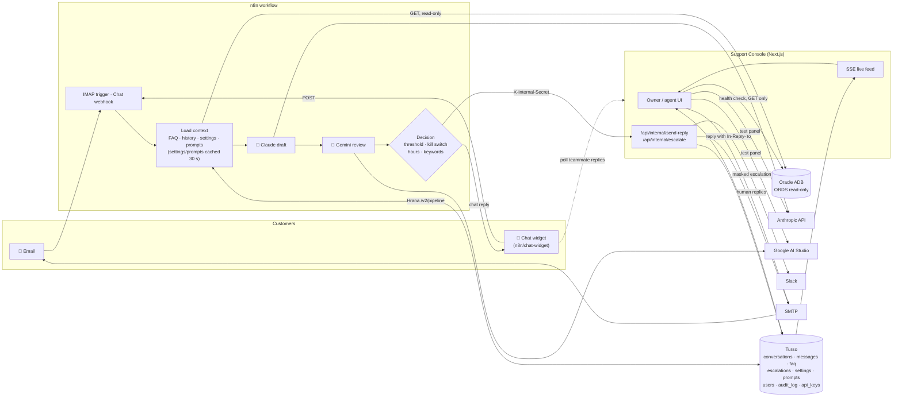

# Support Console

The admin control panel for an AI customer-support system that runs in n8n.
Two models answer customer email and website chat: **Claude** (Anthropic API)
drafts every reply and **Gemini** (Google AI Studio) cross-checks it. A reply
goes out automatically only when both are confident and agree; everything else
is escalated to a human in Slack. Conversations, the FAQ and escalations live in
**Turso**; existing customer accounts are read from **Oracle Autonomous
Database** through read-only ORDS endpoints.

From this console the owner manages everything without touching n8n:
thresholds, models, kill switches, business hours, block lists, the knowledge
base, prompts (with versions and a test panel), integrations, users, the audit
log and data requests. The n8n workflow reads the same Turso tables and picks
up changes within 30 seconds.

```
/
├── app/                      # Next.js App Router: pages (server components) and route handlers
│   ├── (auth)/login, accept-invite
│   ├── (dashboard)/          # dashboard, conversations, escalations, faq, prompts,
│   │                         # settings, integrations, users, audit, data
│   └── api/                  # auth, module APIs, SSE stream, internal (n8n), public (widget), cron
├── components/               # shadcn/ui-style primitives and app components
├── lib/                      # db, crypto, auth, audit, validators (zod), ingest, metrics, ...
├── migrations/               # 001–008 plain SQL for Turso
├── scripts/                  # migrate.ts, seed-owner.ts, e2e-server.ts
├── tests/                    # Vitest unit tests, Playwright smoke tests
├── n8n/                      # the n8n workflows, prompts, Oracle/Turso SQL, chat widget
├── Dockerfile, docker-compose.yml, vercel.json, .env.example
└── LICENSE (MIT)
```

---

## 1. Architecture



### Design decisions and trade-offs

- **Turso is the contract.** The console and n8n never call each other for
  configuration: the console writes `settings`, `prompts` and `faq`; n8n reads
  them (settings and prompts are cached for 30 seconds in the workflow's static
  data, the FAQ is queried per message). If the console is down, n8n keeps
  answering with the last cached or built-in values.
- **n8n hands results to the console instead of writing them itself.** After
  deciding, n8n POSTs to `/api/internal/send-reply` or `/api/internal/escalate`
  with a shared secret. The console stores messages, the AI decision and the
  escalation (priority, SLA, reason code), posts the masked Slack alert and, for
  email, sends the reply over SMTP. That keeps masking, SLA and Slack logic in
  one place, and lets email replies carry proper `In-Reply-To`/`References`
  headers (n8n's native Send Email node cannot). Both endpoints are idempotent
  on `requestId`, so n8n retries never double-send. Trade-off: email replies
  need the console to be up; if it is not, n8n's error workflow logs a
  `system_error` escalation directly in Turso and alerts Slack.
- **Realtime through the database.** SSE polls an `events` table every two
  seconds rather than holding state in memory, so it works across serverless
  instances and picks up writes from n8n. Streams close after ~50 seconds and the
  browser reconnects with `Last-Event-ID`, which keeps it inside Vercel's
  function limits. Trade-off: up to ~2 s delay.
- **Rate limits in Turso, not memory**, for the same multi-instance reason. Login
  is limited per IP (20 attempts / 15 min) and per account (5 failures / 15 min).
- **Secrets are write-only.** API keys are encrypted with AES-256-GCM
  (random IV, key name as AAD) using `ENCRYPTION_KEY`. The browser only ever sees
  the last four characters. n8n keeps its own credentials; the console's copies
  are used for its own calls (test panel, health checks, SMTP, Slack).
- **Oracle stays read-only.** The console only calls `GET /support/health` with
  the read-only `SUPPORT_RO` user. Account summaries shown in conversations are
  the masked snapshots n8n captured for verified customers.
- **Server components by default.** Pages query Turso on the server; client
  components handle forms, dialogs, the slider preview and SSE. A per-request
  nonce CSP blocks inline and third-party scripts.

---

## 2. Setup

Requirements: Node.js 20.9+ (24 recommended), **npm 11** (npm 10.9 has a
dependency-resolution bug with this tree; use `npx -y npm@11.6.2 install` if
you're on npm 10), a Turso database, and the n8n workflow from `n8n/`.

```bash
git clone https://github.com/aryebleich/N8N.git support-console
cd support-console
npx -y npm@11.6.2 install

cp .env.example .env
# Fill in APP_URL, TURSO_DATABASE_URL, TURSO_AUTH_TOKEN, ENCRYPTION_KEY,
# INTERNAL_API_SECRET, OWNER_EMAIL, OWNER_PASSWORD (see section 3).
set -a; . ./.env; set +a

npm run migrate        # creates or upgrades every table (safe to re-run)
npm run seed:owner     # creates the first owner from OWNER_EMAIL / OWNER_PASSWORD
npm run build && npm start   # or: npm run dev
```

Seed the example FAQ if you want sample data:
`turso db shell <db> < n8n/turso/seed-faq.sql`.

**Docker Compose:** `docker compose up -d --build`. The `migrate` service runs
migrations and the owner seed, then the `app` service starts on port 3000 and a
small `cron` service calls the retention job daily.

**Vercel:** import the repository, add the variables from `.env.example`, and
deploy. `vercel.json` sets the install command (npm 11), function durations and
a daily cron for `/api/cron/retention` (set `CRON_SECRET`). Run
`npm run migrate` and `npm run seed:owner` once from your machine against the
same Turso database.

---

## 3. Environment variables

| Name | Purpose | Required | Example |
|---|---|---|---|
| `APP_URL` | Public URL of the console; used for links in Slack and emails and for the Origin check | Required | `https://support-admin.example.com` |
| `TURSO_DATABASE_URL` | Turso database shared with n8n (`file:` works for local dev) | Required | `libsql://support-bot-yourorg.turso.io` |
| `TURSO_AUTH_TOKEN` | Turso auth token | Required for Turso | `eyJhbGciOi…` |
| `ENCRYPTION_KEY` | 32-byte base64 key for AES-256-GCM encryption of stored API keys | Required | output of `openssl rand -base64 32` |
| `INTERNAL_API_SECRET` | Shared secret n8n sends in `X-Internal-Secret` (≥ 24 chars) | Required | output of `openssl rand -hex 32` |
| `OWNER_EMAIL` | First owner account (seed script) | Required for seeding | `owner@example.com` |
| `OWNER_PASSWORD` | First owner password, ≥ 12 chars with letters and a digit | Required for seeding | `a long passphrase 2026` |
| `OWNER_NAME` | Display name of the first owner | Optional | `Ada` |
| `OWNER_RESET` | `true` resets an existing owner's password and role when re-seeding | Optional | `false` |
| `N8N_CHAT_WEBHOOK_URL` | Chat webhook URL, shown in Settings with a copy button | Optional | `https://n8n.example.com/webhook/support-chat` |
| `WIDGET_ALLOWED_ORIGINS` | Origins allowed to call the public widget endpoints | Optional | `https://shop.example.com` |
| `CRON_SECRET` | Bearer secret for `/api/cron/retention` | Optional (needed for retention) | output of `openssl rand -hex 24` |
| `SESSION_TTL_HOURS` | Session lifetime | Optional | `12` |
| `TRUST_PROXY` | Read the client IP from `X-Forwarded-For` | Optional | `true` |
| `ANTHROPIC_API_KEY`, `GOOGLE_AI_API_KEY`, `SLACK_BOT_TOKEN`, `ORACLE_ORDS_PASSWORD`, `IMAP_PASSWORD`, `SMTP_PASSWORD` | Fallbacks used only when the key is not saved under Integrations | Optional | — |

---

## 4. Creating the services

**Turso database and token**

```bash
turso auth login
turso db create support-bot
turso db show support-bot --url        # → TURSO_DATABASE_URL (libsql://...)
turso db tokens create support-bot     # → TURSO_AUTH_TOKEN, also used by n8n (Bearer Auth credential)
```

`npm run migrate` creates every table, including the base support tables from
`n8n/turso/schema.sql`, so you do not need to apply that file separately.

**Oracle ORDS read-only user.** Run `n8n/oracle/ords-setup.sql` as ADMIN (see
`n8n/README.md` → Oracle setup). It creates `SUPPORT_RO` with `CREATE SESSION`
and `SELECT` on three support views only, and the ORDS module `/support/`. In the
console, open **Integrations → Oracle ORDS**, enter the base URL
(`https://<host>/ords/support_ro`), the user `SUPPORT_RO` and its password,
then **Test connection** (it calls `GET /support/health` only).

**Anthropic key.** Claude Console (<https://platform.claude.com>) → **API keys
→ Create key**. Paste it under **Integrations → Anthropic**; the test checks that
the key can see the configured model.

**Google AI Studio key.** <https://aistudio.google.com> → **Get API key →
Create API key**. Paste it under **Integrations → Google AI Studio**.

The same two keys also go into n8n credentials (see `n8n/README.md`), because
n8n calls the models directly. Slack (bot token with `chat:write`), IMAP and
SMTP are configured the same way under Integrations.

---

## 5. Connecting n8n to the console

1. Generate the secret: `openssl rand -hex 32`. Put it in the console's
   `INTERNAL_API_SECRET`.
2. In n8n, create a **Header Auth** credential named
   **Admin Site Shared Secret (X-Internal-Secret)**: Name `X-Internal-Secret`,
   Value = the secret.
3. Import `n8n/workflows/support-dual-llm.json` and
   `n8n/workflows/error-handler.json`. In the main workflow's **⚙️ CONFIG**,
   set `ADMIN_SITE_URL` to this console's URL, plus the Turso and ORDS URLs.
4. The **🌐 Site: Deliver** node calls:

| Endpoint | When | Body (JSON) |
|---|---|---|
| `POST /api/internal/send-reply` | Auto-reply approved | `requestId`, `conversation{id, channel, customerEmail, customerName, oracleCustomerId, subject}`, `customerMessage{body, receivedAt}`, `reply{text, html}`, `deliver` (true for email), `email{to, subject, inReplyTo, references[], quotedText, quotedHtml}`, `decision{claude, gemini, threshold, bothValid, geminiAgrees, anyNeedsHuman, forceHuman, reasons[], reasonCode}`, `account`, `meta` |
| `POST /api/internal/escalate` | Human needed | same, plus `escalation{reasonCode, reason, priority, notifySlack}` |

Both need the header `X-Internal-Secret`. Responses are
`{ ok, conversationId, customerMessageId, replyMessageId, delivery{status, messageId, error}, escalationId, slackTs }`.
Requests are validated with zod (`lib/validators.ts`) and are idempotent on
`requestId`. Test the connection:

```bash
curl -i -X POST "$APP_URL/api/internal/escalate" -H "X-Internal-Secret: wrong" -d '{}'   # → 401
```

5. For the chat widget, set `data-site-url` (or `SITE_URL` in `widget.js`) to the
   console URL and add the shop's origin to `WIDGET_ALLOWED_ORIGINS`. The widget
   then shows the greeting from **Prompts → Chat greeting** and receives
   teammates' replies.

---

## 6. Adjusting the confidence threshold

**Settings → Confidence threshold.** A reply auto-sends only when Claude's and
Gemini's confidence are both at or above the threshold, Gemini agrees, neither
model asks for a human, both returned valid JSON, and no policy check fires
(kill switch, business hours, blocked keyword, identity or privacy checks).

- The slider shows, live, how many of the last 30 days' decisions would have
  auto-sent at that value, before you save.
- Turn on a **separate threshold** for email or chat to override the default for
  that channel.
- **Lower** (e.g. 0.6): more replies go out automatically, fewer reach your
  team, and the risk of a slightly wrong answer rises.
- **Higher** (e.g. 0.9): fewer automatic replies, more escalations, safer.
  Raising it never makes the system less safe.
- Changes apply to the next message within 30 seconds and are written to the
  audit log with the old and new value.

---

## 7. Editing prompts safely

1. Open **Prompts** and choose a prompt. Variables such as `{{company_name}}`,
   `{{customer_name}}`, `{{faq_context}}` and `{{account_context}}` are
   highlighted; unknown or misplaced variables are flagged in red and block
   saving. `{{faq_context}}` is required in the Claude system prompt.
2. Use **Test prompt** with a few real customer messages before saving. It runs
   the unsaved text through Claude and Gemini with live FAQ retrieval and shows
   both JSON outputs and whether the reply would auto-send. Nothing is sent to
   a customer.
3. **Save** creates a new version with your note. Two people editing at once
   cannot overwrite each other (the second save is rejected with a reload
   prompt).
4. **Version history** shows who changed what; pick any version to see a diff
   against the editor, and **Restore** saves it as a new version.

---

## 8. Production security checklist

- [ ] `APP_URL` uses HTTPS; the app sets HSTS, a nonce-based CSP, `X-Frame-Options: DENY` and `__Host-` session cookies.
- [ ] `ENCRYPTION_KEY` is random, stored in your secret manager and backed up (losing it makes saved API keys unreadable; rotate by re-entering keys).
- [ ] `INTERNAL_API_SECRET` is at least 32 random characters and matches the n8n credential; rotate both together.
- [ ] `ALLOW_INSECURE_COOKIES` is **not** set (it exists only for local end-to-end tests).
- [ ] The first owner's password is long and unique; extra people are invited as **agents** unless they need settings access.
- [ ] Turso token is scoped to this database; the Oracle user is `SUPPORT_RO` (SELECT on the three views only).
- [ ] `WIDGET_ALLOWED_ORIGINS` and the n8n `WEBHOOK_ALLOWED_ORIGINS` list only your sites.
- [ ] `CRON_SECRET` is set if retention is on.
- [ ] `TRUST_PROXY=true` only behind a proxy that sets `X-Forwarded-For` (Vercel, a load balancer).
- [ ] Review **Audit log** regularly; it is append-only (the database rejects updates and deletes).
- [ ] Keep n8n's own credentials (Anthropic, Google, Turso, ORDS, IMAP) in n8n's encrypted credential store, with `N8N_ENCRYPTION_KEY` backed up.

---

## 9. Acceptance tests

Run these after setup. Automated equivalents run in CI-style tests:
`npm test` (38 unit/integration tests) and `npm run build && npm run test:e2e`
(9 Playwright smoke tests against a fresh local database).

| # | Steps | Expected |
|---|---|---|
| 1 | Sign in as owner. **Knowledge base** → edit "How long does shipping take?" to say "2 to 4 business days". In the chat widget ask "How long does shipping take?" | The next reply uses the new text (FAQ is read per message; no redeploy). The conversation appears under **Conversations** with the decision. |
| 2 | Email the support inbox an unusual question, e.g. "Can I use the kettle on a 3500 W commercial induction range?" | **Escalations** shows a new row with reason code *Unusual question* (or *Models disagree*), priority and SLA timer. Slack shows the masked summary with a link to the conversation. The customer gets the holding reply in the same thread. |
| 3 | Ask "What is your return policy?" in the chat widget | Formatted answer within 10 seconds; **Conversations** shows it as *Auto-replied* with both confidence scores. |
| 4 | **Settings → Email auto-reply** → turn off and confirm. Within 30 seconds, email a FAQ question | The email is escalated with reason *Auto-reply off*; the customer gets the holding reply; **Audit log** shows `settings.kill_switch` with old and new values. Turn it back on. |
| 5 | **Settings → Confidence threshold** → move the default to 0.6 (don't save yet) | The preview line updates immediately (e.g. "4 of 5 recent messages would have been sent automatically"). Save writes an audit entry. |

---

## 10. Five-minute setup video: narration script

1. **(0:00)** "This is the control panel for our AI support. Claude drafts,
   Gemini checks, and anything uncertain comes to us. Let's set it up."
2. **(0:15)** Show the repo: the Next.js app at the root, the n8n workflow in
   `n8n/`.
3. **(0:30)** Create the Turso database and token in the terminal; copy the URL
   and token into `.env`.
4. **(0:55)** Generate `ENCRYPTION_KEY` and `INTERNAL_API_SECRET` with openssl;
   set `OWNER_EMAIL` and `OWNER_PASSWORD`.
5. **(1:15)** Run `npm run migrate` and `npm run seed:owner`; show the
   "applied 001…008" output.
6. **(1:35)** `npm run build && npm start`; sign in as the owner. Tour the
   sidebar.
7. **(1:55)** **Integrations**: paste the Anthropic, Google, Slack, ORDS and
   SMTP credentials; click **Test connection** on each and show the latency and
   the masked last four characters.
8. **(2:40)** **Settings**: set the Slack channel ID and click **Send test
   message**; set the company name; copy the endpoint URLs.
9. **(3:05)** In n8n: create the *Admin Site Shared Secret* credential, import
   both workflows, set `ADMIN_SITE_URL` in CONFIG, activate.
10. **(3:35)** Send a chat question from the widget; watch it appear live under
    **Conversations** with both confidence scores.
11. **(4:00)** Send an unusual email; open **Escalations**, show the reason code
    and SLA, click into the conversation, **Approve and send** the draft.
12. **(4:30)** **Prompts**: change the chat greeting, run **Test prompt** on the
    Claude prompt, save, and show the diff in version history.
13. **(4:50)** "Thresholds, kill switches and the FAQ all live here now, and
    every change is in the audit log."

---

## Development

```bash
npm run dev            # http://localhost:3000 (set TURSO_DATABASE_URL=file:./data/dev.db for a local DB)
npm run typecheck
npm test               # Vitest: crypto, templates, CSV/FAQ import, masking, validators, migrations, ingest
npm run build && npm run test:e2e   # Playwright smoke tests (fresh SQLite DB, seeded owner)
```

## License

MIT. See [LICENSE](LICENSE).
