# n8n workflow: dual-LLM customer support (Claude + Gemini)

The n8n half of the system. Two models answer customer email (IMAP) and website
chat (webhook):

- **Claude** (Anthropic API) drafts the reply from the FAQ, the conversation
  history and, for verified customers, their own Oracle account data.
- **Gemini** (Google AI Studio) cross-checks every draft.
- The reply goes out automatically only when both are confident and agree and
  no policy check fires; otherwise it is escalated to a human.

The **Support Console** at the repository root is the control panel: settings,
kill switches, thresholds, prompts, FAQ, escalations and integrations are
managed there and stored in Turso. This workflow reads them (cached 30 s) and
hands every outcome to the console, which sends email replies, records
everything and posts Slack alerts. See the root [README](../README.md).

```
n8n/
├── workflows/
│   ├── support-dual-llm.json   # main workflow (60 nodes incl. 11 sticky notes)
│   └── error-handler.json      # Error Trigger → Turso system_error escalation + Slack
├── prompts/                    # default prompt texts (also seeded by the console migrations)
├── oracle/ords-setup.sql       # read-only user, views, grants, ORDS handlers, OAuth client
├── turso/schema.sql, seed-faq.sql
├── chat-widget/                # embeddable widget + GitHub Pages demo
├── docs/sample-faq.md
├── tests/sample-messages.md
└── .env.example
```

---

## 1. Architecture

```mermaid
flowchart LR
  IMAP["📥 IMAP trigger"] --> CFG["⚙️ CONFIG → 📝 PROMPTS → 🧭 NORMALIZE"]
  HOOK["💬 Chat webhook"] --> CFG
  CFG --> OR["🏦 ORDS customer lookup (4 s, read-only)"]
  CFG --> TL["🗄️ Turso: history · FAQ · session token<br/>+ console settings & prompts (cached 30 s)"]
  OR --> AS["🧩 Assemble + identity check<br/>blocked senders"]
  TL --> AS
  AS -->|verified| ACC["🏦 orders + tickets"] --> CL
  AS --> CL["🤖 Claude (strict JSON)"] --> GM["🔎 Gemini review"] --> PG["🛡️ Policy Guard<br/>threshold per channel · kill switch<br/>business hours · blocked keywords"]
  PG --> D{"✅ Auto-send?"}
  D -->|yes| A["✉️ Auto reply"]
  D -->|no| E["🧑‍💼 Holding reply + reason code"]
  A --> R{"channel"}
  E --> R
  R -->|chat| RESP["💬 Respond to webhook"] --> SITE
  R -->|email| SITE["🌐 Site: Deliver<br/>/api/internal/send-reply · /escalate"]
  SITE --> CON["Support Console<br/>SMTP (threaded) · Turso · Slack"]
  ERR["🚨 error-handler.json"] -.-> T2["Turso system_error + Slack"]
```



### Design decisions

- **Oracle through ORDS handlers**, over three views that exclude payment data
  and internal notes. `SUPPORT_RO` can only `SELECT` those views. Every call has
  a 4-second timeout and no retry; failures become `account_lookup =
  "unavailable"`, which escalates account questions but still answers FAQ ones.
- **Identity before account data.** Email: sender address equals the account
  email. Chat: a session token from Turso `session_tokens` whose email and
  customer id match the account. Unverified Oracle data never reaches a model.
- **Console settings at runtime.** The Turso read for each message also loads
  `settings` and `prompts` when the 30-second cache in the workflow's static data
  has expired. Console values override ⚙️ CONFIG and 📝 PROMPTS, which remain the
  fallback.
- **One place for the Turso wire format:** **🗄️ Turso: Encode Pipeline** builds
  the Hrana `/v2/pipeline` body for every read.
- **Strict JSON from both models** (Claude structured outputs, Gemini
  `responseSchema`), validated field by field; malformed output escalates with
  reason `parse_error`.
- **Exponential backoff for the model calls** (0.5 s/1 s for chat inside the
  8-second budget, 1/2/4 s for email) via Switch → Wait loops, since n8n's
  native retry is fixed-interval.
- **Delivery through the console.** The console sends email with real
  `In-Reply-To`/`References` threading headers (the native Send Email node
  cannot), stores the decision, applies the SLA and posts the masked Slack alert.
  Its endpoints are idempotent on `requestId`, so the node's 3 retries never
  double-send.

### Limitations

- n8n executes the "parallel" Oracle and Turso branches one after another; an
  ORDS outage adds its 4-second timeout to the chat reply time.
- Chat is answered before the console is called. If the console is down, the
  customer still gets the answer, but the conversation is not recorded; the
  error workflow logs a `system_error` escalation and alerts Slack.
- Email replies need the console to be reachable.

---

## 2. Prerequisites

| Need | Notes |
|---|---|
| **n8n** | Tested on n8n 2.46.6 (self-hosted). Keep execution order `v1` (set in the workflow). |
| **Support Console** | Deployed and migrated (root README), with `INTERNAL_API_SECRET` set. |
| **Turso** | Database and token; tables created with `npm run migrate` from the repo root. |
| **Oracle ADB** | ORDS enabled (default on ADB); ADMIN access to run `oracle/ords-setup.sql`. |
| **Anthropic / Google AI Studio** | API keys (also saved in the console for its test panel). |
| **Mailbox** | IMAP access for the support inbox (SMTP is configured in the console). |

---

## 3. Oracle setup

1. **Edit the four `DEFINE` lines** at the top of `oracle/ords-setup.sql`:
   `app_schema` (the schema that owns your customer tables), `ro_password`,
   `tns_alias` (e.g. `mydb_high`) and `support_mail`.
2. **Map your tables (only if they differ).** The script creates demo
   tables (`CUSTOMERS`, `ORDERS`, `ORDER_ITEMS`, `SUPPORT_TICKETS`) only when
   `app_schema` has no `CUSTOMERS` table. If you have real tables with other
   names or columns, change only the `SELECT` lists of the three views in
   step 2 of the script, keeping the column aliases.
3. **Run it as ADMIN with SQLcl:**

   ```bash
   sql /nolog
   SQL> set cloudconfig /path/to/Wallet_mydb.zip
   SQL> connect admin@mydb_high
   SQL> @oracle/ords-setup.sql
   ```

   Part 1 (as ADMIN) creates the views and the read-only user and REST-enables
   it; Part 2 reconnects as `SUPPORT_RO` and defines the ORDS module. With
   Database Actions instead of SQLcl, run Part 1 as ADMIN, then sign in as
   `SUPPORT_RO` and run Part 2 (from the `CONNECT` line down).

   The grants the script applies:

   ```sql
   GRANT CREATE SESSION TO support_ro;
   GRANT SELECT ON SHOP.support_customers_v TO support_ro;
   GRANT SELECT ON SHOP.support_orders_v    TO support_ro;
   GRANT SELECT ON SHOP.support_tickets_v   TO support_ro;
   ALTER USER support_ro QUOTA 0 ON data;
   ```

4. **Handlers, not AutoREST.** The script uses ORDS handler definitions
   (module `support.v1`, base path `/support/`). AutoREST stays off for these
   objects; `p_auto_rest_auth => TRUE` keeps anything AutoREST-enabled later
   behind authentication.
5. **Confirm with curl** (base URL is `https://<host>/ords/support_ro`):

   ```bash
   ORDS=https://your-adb-id.adb.us-ashburn-1.oraclecloudapps.com/ords/support_ro
   curl -u SUPPORT_RO:'your-password' "$ORDS/support/health"
   curl -u SUPPORT_RO:'your-password' "$ORDS/support/customers/by-email/ada.okafor%40example.com"
   curl -u SUPPORT_RO:'your-password' "$ORDS/support/customers/C-10042/orders?limit=5"
   curl -u SUPPORT_RO:'your-password' "$ORDS/support/customers/C-10042/tickets?limit=5"
   # Without credentials every call must return 401:
   curl -i "$ORDS/support/customers/C-10042/orders"
   ```

   Expected shapes:

   ```json
   {"customer_id":"C-10042","full_name":"Ada Okafor","email":"ada.okafor@example.com","plan":"plus","status":"active","created_at":"2024-03-14T10:12:00Z"}
   {"items":[{"order_id":"NW-58211","order_date":"…","status":"shipped","total":129.9,"currency":"USD","carrier":"UPS","tracking_number":"1Z999AA10123456784","items":[{"sku":"KTL-200","name":"Stovetop kettle, 2 L","quantity":1}]}],"hasMore":false,"limit":5,…}
   ```

6. **Authentication options.** The workflow ships with **Basic Auth** as
   `SUPPORT_RO` (ORDS database authentication). To use **OAuth2** instead,
   take the `client_id` and `client_secret` the script prints, create an n8n
   *OAuth2 API* credential (grant type *Client Credentials*, Access Token URL
   `<ORACLE_ORDS_BASE_URL>/oauth/token`), and switch the three 🏦 HTTP nodes to
   *Predefined credential type → OAuth2 API*.

---

## 4. Turso setup

```bash
turso auth login
turso db create support-bot
turso db show support-bot --url          # → libsql://support-bot-yourorg.turso.io
turso db tokens create support-bot       # → the Bearer token for n8n

# From the repository root: creates every table (support tables + console tables)
TURSO_DATABASE_URL=libsql://support-bot-yourorg.turso.io TURSO_AUTH_TOKEN=eyJ... npm run migrate
turso db shell support-bot < n8n/turso/seed-faq.sql     # optional example FAQ
```

`turso/schema.sql` is the base schema the console migration `001` contains
verbatim; the workflow also needs the console's later migrations (settings,
prompts, extra escalation columns), so use `npm run migrate`.

Use the URL with `https://` in CONFIG (`libsql://` is also accepted and
converted). Confirm the HTTP endpoint the workflow uses:

```bash
export TURSO_DATABASE_URL=https://support-bot-yourorg.turso.io
export TURSO_AUTH_TOKEN=eyJ...
curl -s "$TURSO_DATABASE_URL/v2/pipeline" \
  -H "Authorization: Bearer $TURSO_AUTH_TOKEN" \
  -H "Content-Type: application/json" \
  -d '{"requests":[{"type":"execute","stmt":{"sql":"SELECT count(*) AS n FROM faq"}},{"type":"close"}]}'
# → {"baton":null,"base_url":null,"results":[{"type":"ok","response":{"type":"execute","result":{"cols":[{"name":"n",...}],"rows":[[{"type":"integer","value":"12"}]],...}}},{"type":"ok","response":{"type":"close"}}]}
```

If your Turso database rejects the FTS5 section of `schema.sql`, delete the
`faq_fts` table and its three triggers from the file and re-run it. Retrieval
then uses the LIKE fallback automatically.

---

## 5. n8n setup, step by step

1. **Import** `workflows/error-handler.json`, then `workflows/support-dual-llm.json`,
   or let GitHub Actions do it (see *Automatic deploys* below).
2. **Credentials** (names below are picked up automatically):

   | Type | Name | Fields | Used by |
   |---|---|---|---|
   | Header Auth | `Anthropic API Key (x-api-key)` | Name `x-api-key`, Value = key | main |
   | Query Auth | `Google AI Studio Key (key)` | Name `key`, Value = key | main |
   | Bearer Auth | `Turso Auth Token (Bearer)` | Bearer token | main, error |
   | Basic Auth | `Oracle ORDS SUPPORT_RO (Basic Auth)` | `SUPPORT_RO` + password | main |
   | Header Auth | `Admin Site Shared Secret (X-Internal-Secret)` | Name `X-Internal-Secret`, Value = console `INTERNAL_API_SECRET` | main |
   | IMAP | `Support Mailbox (IMAP)` | host, port 993, user, password, TLS | main |
   | Slack API | `Slack Bot (support alerts)` | `xoxb-…` with `chat:write` | error |

3. **⚙️ CONFIG** (main workflow):

   | Field | Default | What it does |
   |---|---|---|
   | `ADMIN_SITE_URL` | placeholder | Support Console URL, e.g. `https://support-admin.example.com` |
   | `TURSO_DATABASE_URL` | placeholder | `https://<db>-<org>.turso.io` (`libsql://` accepted) |
   | `ORACLE_ORDS_BASE_URL` | placeholder | `https://<host>/ords/support_ro` |
   | `SUPPORT_FROM_EMAIL` | `support@example.com` | Mail from this address is ignored (loop protection) |
   | `CHAT_TIMEOUT_MS` | `8000` | Time budget for a chat reply, retries included |
   | `ORACLE_LOOKUP_TIMEOUT_MS` | `4000` | Hard timeout per ORDS call |
   | `HISTORY_MESSAGE_LIMIT`, `FAQ_RESULT_LIMIT`, `MAX_MESSAGE_CHARS` | `10`, `5`, `4000` | Context sizes |
   | `WEBHOOK_ALLOWED_ORIGINS` | `*` | Origins allowed to use the chat webhook (403 otherwise) |
   | `CONFIDENCE_THRESHOLD`, `CLAUDE_MODEL`, `CLAUDE_EFFORT`, `CLAUDE_REFUSAL_FALLBACK`, `GEMINI_MODEL`, `MAX_TOKENS`, `LLM_TIMEOUT_MS`, `COMPANY_NAME`, `SUPPORT_SIGNATURE` | see node | **Fallbacks only.** The console's Settings override these at runtime. |

   In `error-handler.json`'s ⚙️ CONFIG set `TURSO_DATABASE_URL` and `SLACK_CHANNEL_ID`.
4. **Error workflow:** main workflow → Settings → Error workflow → `Support · Error Handler`.
5. **Activate** (n8n 2.x: *Publish*) and copy the production chat webhook URL
   into the widget and into the console's `N8N_CHAT_WEBHOOK_URL`.

---

### Automatic deploys from GitHub

The **Deploy n8n workflows** action (`.github/workflows/deploy-n8n.yml`) runs
`scripts/deploy-n8n.mjs` whenever `n8n/workflows/` changes on `main`. It
creates or updates both workflows through the n8n public API, keeps the
credentials you selected and your ⚙️ CONFIG values, links the error workflow
and activates both.

1. n8n → **Settings → n8n API → Create an API key** with the scopes
   `workflow:*` and `credential:list` (the latter lets the script pick the
   credentials named in the table above on a first deploy).
2. GitHub → **Settings → Secrets and variables → Actions**: add `N8N_API_URL`
   (e.g. `https://n8n.example.com`) and `N8N_API_KEY`. Optionally add
   `N8N_CONFIG_JSON`, e.g.
   `{"ADMIN_SITE_URL":"https://support-admin.example.com","TURSO_DATABASE_URL":"https://db-org.turso.io","ORACLE_ORDS_BASE_URL":"https://…/ords/support_ro","SLACK_CHANNEL_ID":"C0123456789"}`.
3. Run it once from **Actions → Deploy n8n workflows → Run workflow**.

---

## 6. What the console controls

| Console page | Effect in this workflow (within 30 s) |
|---|---|
| Settings → thresholds | Per-channel threshold used by 🛡️ Policy Guard and the DECISION node |
| Settings → models, max tokens, timeout | Claude/Gemini model ids, `max_tokens`, email request timeout |
| Settings → kill switch | Channel off → every message escalates (`kill_switch`); drafts are still produced |
| Settings → business hours | Outside hours → escalate (`outside_hours`); "holding" mode skips the Slack ping |
| Settings → blocked senders / keywords | Senders ignored entirely (chat gets 403); keywords force escalation (`blocked_keyword`, high priority) |
| Settings → company name, support address | Prompts, greetings, loop protection |
| Prompts | Claude system prompt, Gemini reviewer, holding message, email signature (`{{variables}}`) |
| Knowledge base | FAQ rows retrieved per message (FTS5, LIKE fallback) |

Reason codes sent to the console: `low_confidence`, `models_disagree`,
`unusual_question`, `parse_error`, `kill_switch`, `outside_hours`,
`blocked_keyword`, `policy` (identity/privacy checks); the console adds
`delivery_failed`, and the error workflow `system_error`.

---

## 7. Chat widget

`chat-widget/widget.js` works on any static site. The **Deploy chat widget to
GitHub Pages** action publishes it on every change, at
`https://aryebleich.github.io/N8N/widget.js` (the older
`https://aryebleich.github.io/N8N/chat-widget/widget.js` keeps working):

```html
<script src="https://aryebleich.github.io/N8N/widget.js"
        data-webhook-url="https://your-n8n-host/webhook/support-chat"
        data-site-url="https://support-admin.example.com"
        data-title="Northwind Goods support"
        defer></script>
```

- `data-webhook-url` (or `WEBHOOK_URL` in the file): the n8n chat webhook.
- `data-site-url` (or `SITE_URL`): the console. The widget then loads the greeting
  from **Prompts → Chat greeting** and polls every 15 s for teammates' replies to
  escalated chats. Add the shop's origin to the console's `WIDGET_ALLOWED_ORIGINS`.
- Signed-in customers: your login backend writes a row to Turso `session_tokens`
  and passes the token via `data-session-token`/`data-customer-email` or
  `SupportChat.identify({ token, email, name })`. The widget keeps the token the
  server confirms and drops one it rejects.

The demo page is `chat-widget/index.html`.

---

## 8. Data handling

- **Read from Oracle:** customer id, name, email, plan, status; 5 recent orders
  (no payment data); 5 recent tickets (no notes). Only for verified customers.
  Never written.
- **Sent to the models:** message, recent history, FAQ rows, and for verified
  customers the account data above.
- **Written (by the console):** conversations, messages, AI decisions (with a
  masked account summary: name, plan, status, last 3 orders), escalations.
  Retention, CSV export and per-customer deletion are in the console's
  **Data tools**.

---

## 9. Troubleshooting

| Symptom | Fix |
|---|---|
| `🌐 Site: Deliver` fails with 401 | The Header Auth value must equal the console's `INTERNAL_API_SECRET`, header name `X-Internal-Secret`. |
| `🌐 Site: Deliver` fails with 400 | The response lists the invalid fields (zod). Usually a missing customer email on chat (the widget requires one). |
| Console settings don't apply | Wait 30 s (cache). The 🧩 Assemble Context output shows `ctx.runtime.source` (`turso`, `cache` or `nodes`); `nodes` means the console tables are missing — run `npm run migrate`. |
| Every message escalates with `parse_error` | Open 🤖 Claude: Parse Draft / 🔎 Gemini: Parse Review for the API error (key, model id, `max_tokens`). |
| `account_lookup = "unavailable"` | ORDS unreachable or 401; check `ORACLE_ORDS_BASE_URL` (ends in `/ords/support_ro`) and the credential. |
| Turso errors in 🗄️ Turso: Decode Results | 401 → new token; `no such table` → run migrations. |
| Chat 403 `origin_not_allowed` | Add the page origin to `WEBHOOK_ALLOWED_ORIGINS` (exact scheme and host). |
| Emails arrive late | IMAP IDLE delays on some providers; use the trigger's *Force reconnect* option. |

---

## Acceptance tests

See [tests/sample-messages.md](tests/sample-messages.md) for the five sample
messages and tests A–E, and the root README for the console acceptance tests.

## License

MIT. See [LICENSE](../LICENSE).
